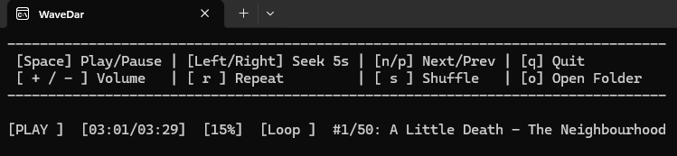
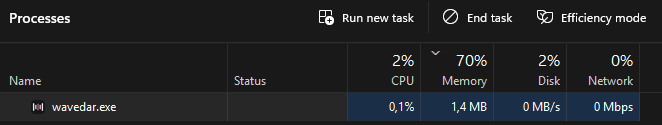

# WaveDar

<p align="center">
  
  <br>
  <b>Lightweight native audio player for Windows</b>
</p>

<p align="center">
  
</p>

WaveDar is a minimalist, standalone audio player for Windows written in C99. It streams local audio directly to Windows WASAPI with zero network traffic, no background telemetry, and zero runtime dependencies.

## Features

- **Low Memory Footprint**: Consumes approximately 1.4 MB of private memory during active playback.
- **Native Audio Streaming**: Direct WASAPI output via miniaudio.
- **Format Support**: Plays MP3, WAV, FLAC, and OGG Vorbis with sample-accurate duration.
- **Auto-Skip Resilience**: Corrupted or unreadable tracks are automatically skipped without stopping the playlist.
- **Native Unicode Console**: Displays multi-language titles (including Japanese, Korean, and Chinese) cleanly via native Windows wide-character console output.
- **Persistent Session**: Automatically restores your last folder, track index, volume, and playback mode.
- **Clean Metadata**: Filters common downloader tags to present clean track titles.
- **100% Offline**: Zero network sockets, zero HTTP requests, and completely standalone.

## Resource Benchmark

WaveDar runs with minimal overhead:

<p align="center">
  
</p>

- **Memory**: ~1.4 MB Private Working Set
- **CPU**: ~0.1% on modern processors
- **Network**: 0 Mbps (completely offline and private)

## Keyboard Controls

| Key | Action |
| :--- | :--- |
| `Space` | Play / Pause |
| `Left` / `Right` | Seek backward / forward 5 seconds |
| `[` / `]` | Seek backward / forward 15 seconds |
| `n` / `p` | Next / Previous track |
| `+` / `-` | Volume up / down (also Up / Down arrow keys) |
| `r` | Toggle single track repeat |
| `s` | Toggle shuffle mode (Fisher-Yates deck) |
| `o` | Open folder (paste path or drag-and-drop) |
| `q` | Save session and quit |

Global multimedia keys (Play/Pause, Next Track, Previous Track, Stop) are also supported while minimized.

## Quick Start

1. Download the latest `wavedar.zip` from the Releases page.
2. Extract the archive to any folder on your computer.
3. Launch `wavedar.exe`.
4. Press `o` and paste or drag-and-drop your music folder.

No installer, runtime, or external codec is required.

## Building from Source

Prerequisites:
- Windows 10 or Windows 11 (64-bit)
- Zig compiler (`zig cc`) or any C99 compiler (MSVC / Clang / GCC)

Run the build script:
```cmd
build.bat
```

This compiles a single standalone binary: `wavedar.exe`.

## License

MIT License. See [LICENSE](LICENSE) for details.
